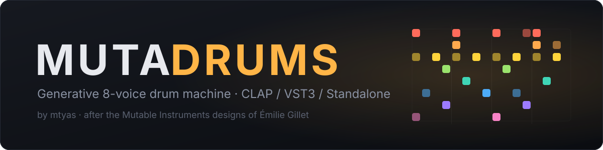
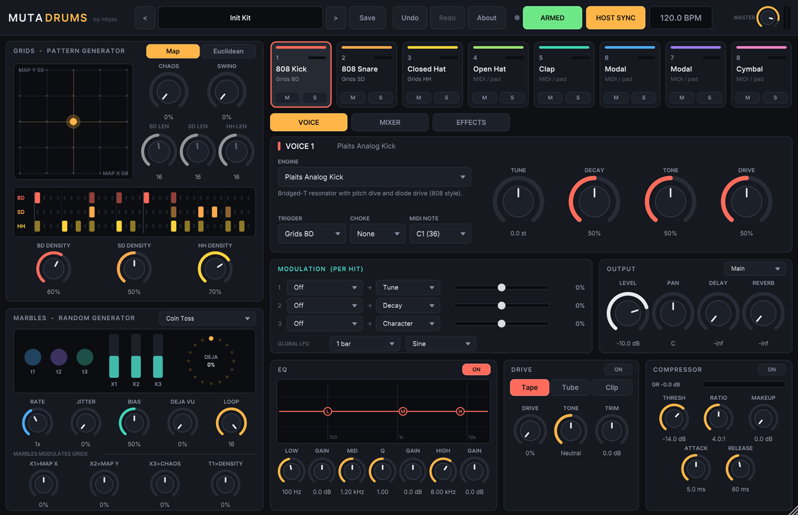
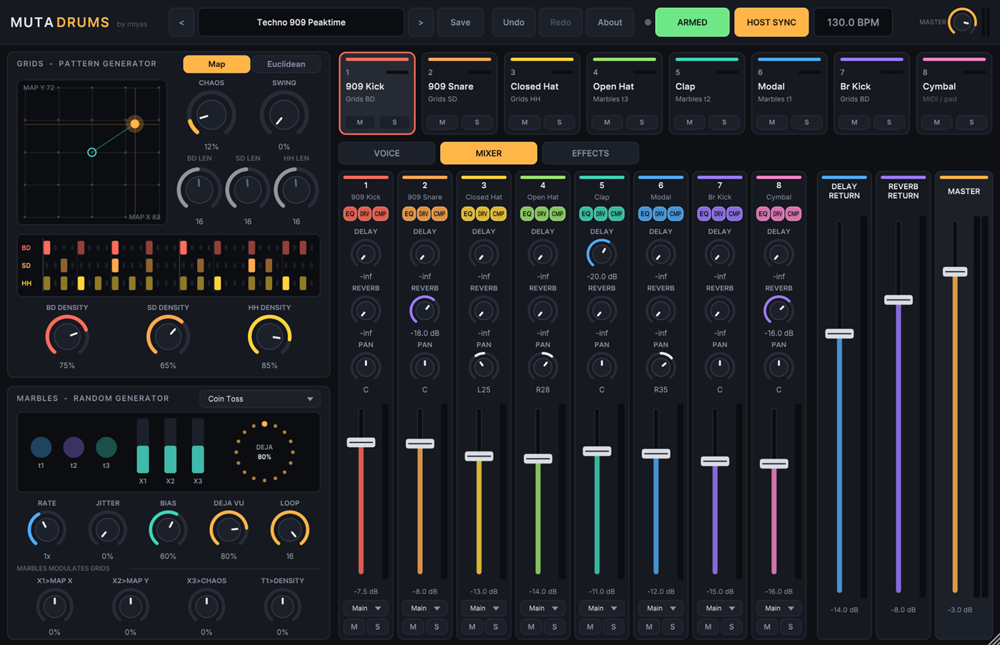

  

  
  
  
  

  <b>Eight drum voices, two generative sequencers, a channel strip per voice, and no two bars quite the same.</b> 
  A love letter to Émilie Gillet's Grids, Marbles, Plaits and Braids, in plugin form.

  

---

## ✨ Features

|  |  |
|---|---|
| 🗺️ **Grids-style patterns** | Drag across a topographic map of drum grooves, or switch to Euclidean rhythms. Density, chaos and swing for each lane, and a 32-step preview of what will play. |
| 🎲 **Marbles-style randomness** | Three gate streams and three random voltages, with Déjà-Vu looping. Use them to trigger voices or to push the Grids map around. |
| 🥁 **12 drum engines** | 808 and 909-style kicks and snares, hats, a modal resonator, a clap, and Braids-style kick, snare, cymbal and bell. |
| 🎛️ **Channel strip per voice** | 3-band EQ you can **drag directly on the curve**, Tape/Tube/Clip drive, compressor, pan, sends, mute and solo. |
| 🔀 **Separate outputs** | Main plus **7 extra stereo outs**. Send any voice to its own DAW mixer channel. |
| 🌊 **Per-hit modulation** | Three slots per voice: Marbles, velocity, random, LFO or bar ramp, sampled fresh on every hit. |
| 🌀 **Effects** | A stereo/ping-pong tape delay and an 8-line FDN reverb with a real RT60. |
| ↩️ **Everything automatable** | About 390 host parameters, sample-accurate MIDI, and undo/redo for everything. |
| 🧰 **Init Kit** | A plain starting point: eight raw sounds with no processing. |

  

## 🚀 Quick start

1. **Get it.** Download a build from [Releases](https://github.com/mtyas/mutadrums/releases) when one is available, or [build it yourself](docs/building.md).
2. **Install** it by copying `Mutadrums.clap` to `C:\Program Files\Common Files\CLAP\` and/or `Mutadrums.vst3` to `C:\Program Files\Common Files\VST3\`, then rescan plugins in your DAW.
3. **Play.** Load Mutadrums on an instrument track and press play. With **HOST SYNC** on it follows your DAW's tempo and transport. Kick, snare and hats follow Grids straight away. Drag the map and listen to the groove morph.
4. **Explore.** Click a pad to select and hear a voice, shape it on the VOICE page, or open **About** inside the plugin for a tour.

## 📚 Documentation

| Guide | What's inside |
|---|---|
| [User guide](docs/user-guide.md) | Every section of the interface, explained |
| [Separate outputs](docs/separate-outputs.md) | Routing voices to their own DAW channels |
| [Presets](docs/presets.md) | Factory and user presets, file locations and format |
| [Building from source](docs/building.md) | Clone, configure and build on Windows and macOS |
| [Credits](docs/credits.md) | Émilie Gillet, Mutable Instruments, and the libraries Mutadrums uses |
| [Changelog](CHANGELOG.md) | What changed in each version |

## 💛 Credits

Mutadrums exists because **Émilie Gillet** designed the [Mutable Instruments](https://pichenettes.github.io/mutable-instruments-documentation/) Eurorack modules and published [their source code](https://github.com/pichenettes/eurorack). The Grids drum maps, the Marbles random sampler, and the Plaits and Braids drum models are her work; this plugin adapts them for the DAW. Thank you, Émilie. Full credits are in [docs/credits.md](docs/credits.md).

Mutable Instruments is a registered trademark. Mutadrums is an independent project and is not affiliated with or endorsed by Mutable Instruments or Émilie Gillet. Module names are used only to credit where the ideas come from.

## ⚖️ Licence

Mutadrums is free software under the **[GNU General Public License v3.0 or later](LICENSE)**. You may use, study, share and modify it. If you distribute it, modified or not, you must share the source under the same licence. The Grids pattern data it includes is © Émilie Gillet under GPL-3.0. See [docs/credits.md](docs/credits.md) for every third-party licence.

Made by <a href="https://github.com/mtyas">mtyas</a>

